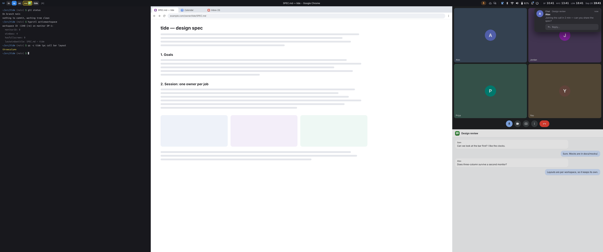

# tide

Formerly quickspace. A small Wayland desktop built for dwm/Krohnkite-style tiling:

- **Hyprland** tiles the windows.
- **Quickshell** draws the bar, launcher, notifications, lock and login
  screens, OSDs and screen-share picker.
- **greetd** logs you in.
- **uwsm** runs the session, with one owner per job, so nothing starts twice.

**Status: milestone 2, session skeleton.** Start with the [spec](SPEC.md).
The mocks are in [`docs/mocks/`](docs/mocks/).

## Installing

Clone this repo and run its installer as yourself (it asks sudo for the
rest) on Debian, Ubuntu, Fedora or Arch:

    git clone https://github.com/mikelward/tide.git
    tide/install/tide-setup

It installs the distro packages, builds what the distro lacks or has too
old from the pins in `deps.lock` (Quickshell, and Hyprland on Debian and
Ubuntu), runs both installs below, enables tide's units, sets up fcitx5
for accents and the browser tabs' host, and checks the session will start.
It leaves the display manager as it is, with tide as one more session;
`--greeter` makes greetd, with tide's greeter, the login screen, and
`--no-greeter` puts back the one it replaced. `--help` lists the rest.
`git pull` and run it again to update.

Each push to main is also a release, tagged `v0.MINOR.<commits>`, on the
repo's Releases page: the source (`tide-TAG.tar.gz`, which the installer
runs from), and the Go commands built for Linux on amd64 and arm64, with
their SHA-256 sums. `make dist` makes the same files in `build/dist`.

By hand, it's:

    make install                       # builds tide-grant, tide-msg, tide-tz, tide-greetd, tide-agent, tide-tabs, tide-pick and tide-kwin-paste (needs Go 1.22+); layout, user units, portal config under ~/.config
    sudo make install-session          # session entry, compositor wrapper, `tide` and the other tide-* commands under /usr/local
    systemctl --user daemon-reload
    systemctl --user enable tide.service tide-clipboard.service tide-fcitx5.service tide-kde.service

`make install` also puts tide's Hyprland config, with its keys and rules,
in `~/.config/hypr/tide/hyprland.lua`. Without a
`~/.config/hypr/hyprland.lua` of your own, the session runs it. To keep
yours and still have tide's keys, load it from yours with your own
options, such as your keyboard layout, terminal and app keys; its first
lines list them (SPEC.md §6.8).

By hand, also install what the session runs: Hyprland 0.57 or later,
Quickshell 0.3 (`qs`, which draws the bar; without it `tide-shell`
falls back to waybar, and with an older one it says so in a
notification), hypridle, hyprlock
(the lock's fallback, when tide's lock can't run), uwsm, waybar, swaync, a polkit agent, swww
or swaybg (for waybar's bar; the Quickshell shell draws its own wallpaper),
notify-send (libnotify), which the shell reports a bad settings
file with, jq, which `tide doctor` reads Hyprland's JSON with, python3,
which it reads the session bus's config with, and NetworkManager's nmcli,
which the network menu lists VPNs with, and wl-clipboard, openssl and
libsecret-tools' secret-tool, which keep the clipboard history the picker
on `Super+V` lists, encrypted (SPEC.md §8.4), and wtype, which types what the picker's Fill tab on
`Super+Shift+V` chooses. `install/tide-setup` installs them all. For Bitwarden
logins on the Fill tab, install rbw, the unofficial Bitwarden client, and
run `rbw config set email` and `rbw login` once. For accents on a held
letter, `install/tide-setup` installs fcitx5 and builds tide's own add-on,
`tide-accents`, which `tide-fcitx5.service` runs in the tide session
(SPEC.md §8.6). By hand, it builds with `make fcitx5` (fcitx5's headers,
CMake and extra-cmake-modules) and installs with
`sudo cmake --install build/fcitx5`.
jq and python3 are free distro packages that run locally, with no network
calls; without one, the doctor reports the check it skipped.

For your browser tabs in the switcher, add tide for Chrome (mikelward/tideco) or
the tide connector to Chrome or Brave. The connector loads unpacked from
`connector/` (`connector/README.md`).

Then pick **tide** at the display manager. It runs Hyprland through
uwsm as `tide-hyprland`, which gives the session its own systemd
target, so tide's units never start in a plain Hyprland or Plasma
login (SPEC.md §5.3). If the display manager doesn't list the session,
install it with `sudo make install-session PREFIX=/usr`.

**tide (tidewm)** is the same session on tidewm, tide's fork of dwl
(mikelward/tidewm), listed only where tidewm is installed:
`install/tide-setup --tidewm` builds it, on Debian, Ubuntu, Fedora and Arch, and
builds the wlroots 0.20 it needs where the distro has none (Ubuntu 26.04,
Debian 13). The shell reads
tidewm's IPC there: the bar's workspaces, windows, title and layout
symbol, the switcher, the launcher's screenshots and the Sharing pill
all work, and screen sharing goes through xdg-desktop-portal-wlr, which
`tide doctor` checks for. It hasn't had a real login yet. Hyprland's
stays the default. tidewm's keys are tide's own config,
`~/.config/tidewm/tide.conf`, which `make install` puts there and the
session runs when you have no `~/.config/tidewm/config`; yours can
`include tide.conf` and rebind what it likes (SPEC.md §6.8).

`make install-session` also installs tide's greeter, for greetd (SPEC.md
§11): `tide-greeter`, which runs Hyprland with its own config and the
greeter on the lock's face, plus a copy of the shell for it and a greetd
config template in `$(PREFIX)/share/tide/greeter/greetd.toml`.
`install/tide-setup --greeter` switches your display manager to it, and
`--no-greeter` switches back. By hand, as root:

- install greetd, and copy the template to `/etc/greetd/config.toml` with
  `user` set to the greeter account your greetd package created;
- give that account a home it can write, where the greeter remembers the
  last login;
- add `auth optional pam_gnome_keyring.so` and `session optional
  pam_gnome_keyring.so auto_start` to `/etc/pam.d/greetd`, so the login
  unlocks the keyring;
- enable greetd in place of the current display manager.

The greeter user has to be able to run `Hyprland` and `qs`, so a build
under someone's home directory won't do.

Key bindings and the launcher start apps with `tide launch [--app ID]...
COMMAND...`: it waits (at most 15 s) for the shell, gives the app a one-shot
focus grant, and runs it with `uwsm app` so it outlives a shell restart.
Repeat `--app` when the app's window class could be any of several IDs.
`--workspace NAME` takes the app's first window to the workspace named
NAME, made if it's new. Without it, a launch from a workspace whose new
windows ask for a name (home, unless the Workspaces settings say otherwise)
asks the shell's name prompt for one first, and waits for the answer. The app gets `TIDE_WORKSPACE`, that workspace's
name (or else the focused one's) with only its letters and digits, in any
script, NFC-normalized,
and `tide workspace` prints the focused workspace's the same way
(SPEC.md §6.5).
Terminal commands get their grants from `tide-grant`, which each shell
runs before a command (SPEC.md §14.3).

Until the Quickshell shell is complete, `tide.service` runs
`tide-shell`, a transitional shell. It runs the Quickshell bar
(`qs -c tide`) when Quickshell and the shell are installed, and waybar
otherwise; conf's theme daemon, which runs swaync (and waybar, when that's
the bar), or without conf, swaync (and waybar) in their default style; a
polkit agent; and, with waybar, swww (or swaybg where swww
isn't packaged) for the wallpaper, which the Quickshell shell draws itself.
It also runs tide's input setup once. It reports ready once
swaync owns the notification name and the bar's tray owns the watcher (see
`TODO.md`). `TIDE_BAR=waybar` in `~/.config/uwsm/env` keeps waybar.

The Quickshell bar has the workspaces by name (the standing ones from
`~/.config/tide/workspaces.json`, home first; SPEC.md §6.5), the layout symbol, the tray, the
clocks and their popover, a keep-awake toggle, network, Bluetooth, volume
and battery with their percentages, the system monitor (CPU %, with top
processes, memory and temperature) and the session menu, plus the volume and mic-mute OSD. To use it, install
Quickshell (above), run `make install` and `sudo make install-session`,
then log in to tide again (or `systemctl --user restart tide`).
The clocks need `tide-tz` on `PATH`, and the system monitor's temperature
and process lists need `tide-sysmon`. Its notification popups are off
while swaync runs;
to try them, stop swaync, run
`systemctl --user set-environment TIDE_NOTIFICATIONS=1` (or put it in
uwsm's `env`), and restart the shell. The lock reads the same setting to
show the notification count, so set it for the session, not just one
process.

The shell can be the polkit agent too, which asks for your password when
an app needs privileges: set `TIDE_POLKIT=1` the same way and restart
the shell, and `tide-shell` starts no other agent. Its prompt takes the
keyboard only right after you press a key (a `pkexec` in a terminal);
otherwise a notification offers **Authenticate**.

The shell asks for network passwords itself, in place of nm-applet
(SPEC.md §5.6). It runs `tide-agent`, NetworkManager's secret agent,
which `make install-session` installs; `TIDE_AGENT=0`, set the same way,
turns it off. Autostart skips nm-applet while the shell's agent runs, and
starts it otherwise (under waybar, say), or when
`~/.config/tide/autostart` lists it; `tide-agent` then stands aside. A Wi-Fi password is asked for in the
network popover, and a VPN's in a prompt of the shell's own, or in the
VPN plugin's window. A request NetworkManager makes on its own, such as a
reconnect, arrives as a notification first. `tide-agent` is also BlueZ's
pairing agent: a device asking to pair, or to use a service, shows as a
notification, then a prompt to confirm, type or show the code. It stands
aside while blueman's applet runs.

`tide doctor` checks the running session and prints one line per
problem, with its fix: units that aren't running, D-Bus names owned by the
wrong process or that D-Bus could start a rival for, daemons running twice
or rivals to an owner, the portal
config, Hyprland's config errors, autostart entries that run in
tide without being on its allowlist, and a lock that couldn't work: its
unit, `lock.qml` or PAM file missing, or the last lock failed; its
hyprlock fallback missing or failed; and
secret-tool or openssl missing, the keyring locked, or
`tide-clipboard.service` stopped. It exits 1
if it found a problem.

XDG autostart is an allowlist in tide. `make install` adds one systemd
drop-in, `app-.service.d/tide-autostart.conf`, that reaches every
autostart unit; in the tide session it skips each entry that
`tide autostart-allowed` doesn't name, so other desktops' daemons and
tray icons stay out, while Plasma runs them all as before. The list is
`nm-applet`, only while the shell's network agent isn't running; add
desktop IDs, one per line, to `~/.config/tide/autostart` to allow more.
When the shell starts, it also stops any autostart program left running from
an earlier login that the list skips, as shpool's sessions keep the user's
services running across a logout.

## Mocks

The mocks are plain HTML/CSS. To re-render the PNGs after editing one:

    make mocks

This needs Node and Playwright with Chromium.

## License

Apache-2.0; see `LICENSE`. The dwl fork explored in SPEC.md §21.1 lives in
its own repository, [mikelward/tidewm](https://github.com/mikelward/tidewm), under
dwl's GPL-3.0-or-later license.
